# StudentHub Portal — Complete Sitemap & Navigation Architecture

This document specifies the hierarchical sitemap, URL routes, user access levels, and navigation flows for the StudentHub portal in accordance with Practical 1.

---

## 1. Visual Hierarchy & Mermaid Sitemap

```mermaid
graph TD
    Root["StudentHub Portal Root (/)"] --> PublicZone["Public & Informational Tier"]
    Root --> AuthZone["Authentication & Account Tier"]
    Root --> StudentZone["Student Workspace Tier"]
    Root --> AdminZone["Administrator Console Tier"]

    PublicZone --> P1["Home (pages/index.html)"]
    PublicZone --> P2["About Us (pages/about.html)"]
    PublicZone --> P3["Helpdesk FAQ (pages/faq.html)"]
    PublicZone --> P4["Feedback (pages/feedback.html)"]
    PublicZone --> P5["Contact Helpdesk (pages/contact.html)"]

    AuthZone --> A1["User Sign In (pages/login.html)"]
    AuthZone --> A2["Student Registration (pages/register.html)"]

    StudentZone --> S1["Student Dashboard (pages/dashboard.html)"]
    StudentZone --> S2["Attendance Analytics (pages/attendance.html)"]
    StudentZone --> S3["Lab Assignments (pages/assignment.html)"]
    StudentZone --> S4["Class Timetable (pages/timetable.html)"]
    StudentZone --> S5["Campus Notices (pages/notice.html)"]
    StudentZone --> S6["Events & Workshops (pages/events.html)"]
    StudentZone --> S7["Student Profile (pages/profile.html)"]

    AdminZone --> AD1["All Students Management (pages/admin.html)"]
    AdminZone --> AD2["Event Management & Pass Dispatcher"]
```

---

## 2. Complete URL Route Mapping Table

| # | Page Name | File Path | Route / URL | Access Permission | Core Functionality |
|:---:|---|---|---|:---:|---|
| 1 | **Home** | `pages/index.html` | `/pages/index.html` | Public | Campus gallery slider, portal introduction, fast links |
| 2 | **About Us** | `pages/about.html` | `/pages/about.html` | Public | Vision, mission, department stats, accreditation |
| 3 | **Registration** | `pages/register.html` | `/pages/register.html` | Public | New student onboarding with validation & hashing |
| 4 | **Login** | `pages/login.html` | `/pages/login.html` | Public | Role-based authentication (Student vs Admin) |
| 5 | **Dashboard** | `pages/dashboard.html` | `/pages/dashboard.html` | Student / Admin | Attendance summary, pending labs, class schedule |
| 6 | **Events** | `pages/events.html` | `/pages/events.html` | Authenticated | Workshop catalog, search/filter, digital pass registration |
| 7 | **Attendance** | `pages/attendance.html` | `/pages/attendance.html` | Student | Theory/Lab percentage breakdown, 80% threshold alerts |
| 8 | **Assignments** | `pages/assignment.html` | `/pages/assignment.html` | Student | Course lab journal submission tracking & deadlines |
| 9 | **Timetable** | `pages/timetable.html` | `/pages/timetable.html` | Student | Daily class schedules, faculty mentors, room slots |
| 10 | **Notice Board** | `pages/notice.html` | `/pages/notice.html` | Public / Student | Mid-semester exam circulars, deadlines, announcements |
| 11 | **Profile** | `pages/profile.html` | `/pages/profile.html` | Authenticated | View & edit student bio, department, emergency contacts |
| 12 | **FAQ** | `pages/faq.html` | `/pages/faq.html` | Public | Collapsible accordion self-service knowledgebase |
| 13 | **Feedback** | `pages/feedback.html` | `/pages/feedback.html` | Public / Student | 5-star rating submission, character count, suggestions |
| 14 | **Contact** | `pages/contact.html` | `/pages/contact.html` | Public | Office hours, helpdesk email, support phone, message form |
| 15 | **Admin Console**| `pages/admin.html` | `/pages/admin.html` | Admin Only | Full student CRUD, modal view, department filtering |

---

## 3. Navigation Management Strategy

1. **Global Header & Navigation Component**:
   Every page implements an identical semantic `<header role="banner">` enclosing a primary `<nav aria-label="Primary Navigation">` with uniform relative hyperlinks (`index.html`, `dashboard.html`, `events.html`, etc.).
2. **Active State Indicators**:
   The current active page is decorated with `class="active"` and the accessible attribute `aria-current="page"`, providing immediate visual and screen-reader context.
3. **Breadcrumb Trail**:
   Each secondary page includes `<nav aria-label="Breadcrumb">` displaying the hierarchy `Home > Current Page`, enabling quick one-click navigation back to previous tiers.
4. **Skip to Main Content**:
   Every page starts with `<a href="#main-content" class="skip-link">Skip to main content</a>` allowing keyboard-only and screen reader users to bypass repetitive header navigation links.
5. **Session-Aware Redirection**:
   Authentication endpoints dispatch students to `dashboard.html` and administrators to `admin.html`. Unauthorized attempts to access admin resources are redirected to `login.html`.
